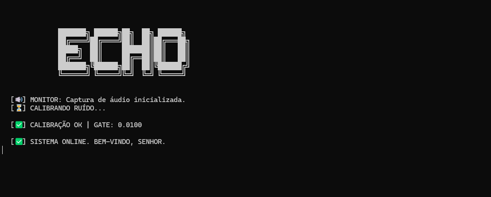

```

                                                                          
              ███████╗ ██████╗██╗  ██╗ ██████╗                                     
              ██╔════╝██╔════╝██║  ██║██╔═══██╗                                    
              █████╗  ██║     ███████║██║   ██║                                    
              ██╔══╝  ██║     ██╔══██║██║   ██║                                    
              ███████╗╚██████╗██║  ██║╚██████╔╝                                    
              ╚══════╝ ╚═════╝╚═╝  ╚═╝ ╚═════╝                                     

```

<h1 align="center">E.C.H.O</h1>
<p align="center">
  <strong>Assistente pessoal de automação por voz — diga uma palavra, o sistema responde.</strong>
</p>

<p align="center">
  
  
  
  
  
  
  
  
</p>

---

## 📖 Sobre o Projeto

Alternar entre abas, abrir pastas, iniciar ferramentas — tarefas simples que interrompem o fluxo de trabalho dezenas de vezes por dia. O **E.C.H.O.** elimina essa fricção.

Desenvolvido para **Windows 11**, o assistente escuta continuamente o microfone em uma thread dedicada, detecta a activation word **"echo"** seguida de um perfil de contexto (como `"trabalhar"` ou `"estudar"`) e executa automaticamente o conjunto de aplicativos e URLs correspondente — tudo sem tirar as mãos do teclado.

O sistema foi construído com foco em **baixo consumo de CPU**, calibração automática de ruído ambiente e proteção de dados pessoais via variáveis de ambiente.


---

## 🛠️ Tech Stack

| Camada | Tecnologia | Função |
|---|---|---|
| Linguagem | Python 3.10+ | Core do sistema |
| Captura de áudio | `sounddevice` | Lê o microfone como array numpy em tempo real |
| Processamento de áudio | `numpy` | Análise de volume e filtragem de silêncio |
| Reconhecimento de fala | `SpeechRecognition` + Google Speech API | Transcrição em pt-BR |
| Concorrência | `threading` (stdlib) | Engine de voz em thread separada sem bloquear o processo |
| Segurança | `python-dotenv` | Caminhos e configurações fora do código-fonte |
| Feedback sonoro | `winsound` (stdlib) | Bipes de resposta pelo alto-falante do sistema |
| Automação | `subprocess` (stdlib) | Abertura de apps, pastas e terminais |

---

## ⚡ Funcionalidades

- 🎤 **Escuta contínua com VAD simples** — captura blocos de áudio de 4s e descarta silêncio automaticamente com base em um gate calculado pela calibração de ruído ambiente
- 🔊 **Calibração automática de ruído** — ao iniciar, o sistema grava 2s de ambiente e ajusta o limiar de detecção dinamicamente
- 🗣️ **Activation word + perfil em uma única frase** — basta dizer *"echo, trabalhar"* para disparar o protocolo correspondente
- ⚙️ **Perfis de automação configuráveis:**
  - `trabalhar` → Abre VS Code + pasta no Explorer
  - `estudar` → Abre o portal acadêmico no Chrome com perfil específico
  - `redes` → Abre terminal CMD e executa scan de rede via `nmap`
  - `música` → Inicia playlist no Spotify via URI nativa
  - `atualizar` → Reinicia o próprio script sem fechar o o terminal 

---

## 🎬 Demonstração



---

## 🚀 Como Rodar o Projeto

### Pré-requisitos

- Python 3.10 ou superior
- Windows 10/11
- Microfone funcional
- [NMAP](https://nmap.org/download.html) instalado (apenas para o perfil `redes`)


### 1. Clone o repositório

```bash
git clone https://github.com/joao-Devr/echo.git
cd echo
```

### 2. Crie e ative o ambiente virtual

```bash
python -m venv .venv
.\.venv\Scripts\Activate.ps1
```

### 3. Instale as dependências

```bash
pip install -r requirements.txt
```

### 4. Configure o arquivo `.env`

Crie um arquivo `.env` na raiz do projeto com base no exemplo abaixo:

```env
# Caminho completo para os executáveis
APP=C:\Program Files\Microsoft VS Code\Code.exe
CHROME_PATH=C:\Program Files\Google\Chrome\Application\chrome.exe

# Nome do perfil do Chrome (ex: Default, Profile 1, Profile 2...)
CHROME_PROFILE=Profile 3

# Pasta que será aberta no Explorer no modo "trabalhar"
EXPLORER_DIR=C:\seu\caminho\aqui

# URI da playlist do Spotify ou da música
MUSIC_URL=spotify:playlist:SEU_ID_AQUI
```

### 5. Rode o projeto

```bash
python echo.py
```

Ou clique duas vezes no `iniciar.bat` (recomendado para uso diário):

```bat
@echo off
cd /d "%~dp0"
call .venv\Scripts\activate
python echo.py
pause
```

---

## 📁 Estrutura do Projeto

```
echo/
├── echo.py          # Código principal
├── iniciar.bat        # Atalho para rodar sem abrir o terminal manualmente
├── requirements.txt   # Dependências do projeto
├── .env               # ❌ NÃO vai para o GitHub — configurações locais
├── .gitignore         # Ignora .env e .venv
└── README.md
```

---

## 🪟 Iniciar Automaticamente com o Windows

Para garantir que o ECHO esteja pronto assim que você ligar o computador, siga o procedimento abaixo utilizando o Método da Pasta Startup:

### Passo a passo

**1. Acessar a pasta de inicialização**
```
Win + R → shell:startup → Enter
```

**2. Criar o atalho**
- Clique com o botão direito dentro da pasta que abriu.
- Selecione Novo > Atalho.
- No campo "Digite o local do item", procure e selecione o seu arquivo **iniciar.bat**.

**3. Confirme** com OK e reinicie para testar.

---

## 👤 Autor

**João Pedro Campolina Rodrigues**

[](https://github.com/Joao-Devr)


---

## 📄 Licença

Este projeto está sob a licença **MIT**. Veja o arquivo [LICENSE](LICENSE) para mais detalhes.

---

<p align="center">
  Feito com 🤖 e Python por <strong>Joao-Devr</strong>
</p>
